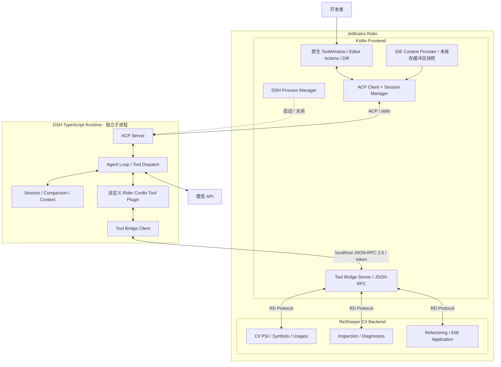
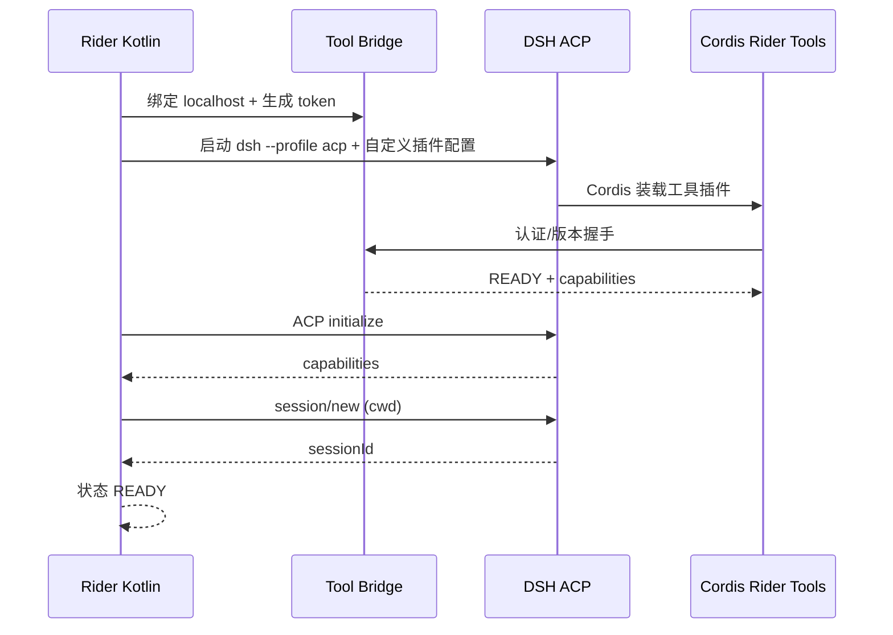
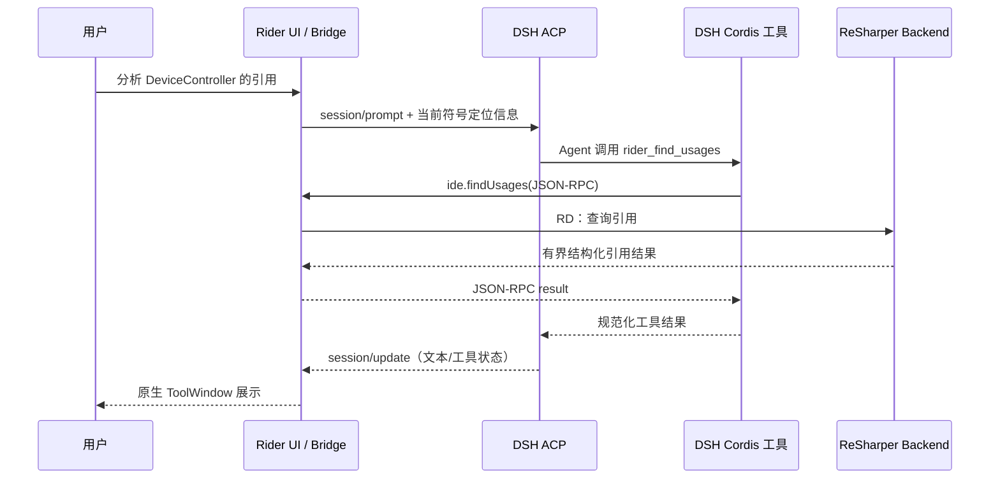

# DSH × JetBrains Rider 原生 Agent 插件——架构设计文档

> **版本**：v0.1（设计基线）<br>
> **日期**：2026-10-26<br>
> **状态**：拟实施，需完成技术验证（Spike）<br>
> **关联清单**：[DSH_Rider_TODO.md](./DSH_Rider_TODO.md)

## 0. 决策摘要

| 议题 | 决策 |
|---|---|
| 宿主 | JetBrains Rider，优先兼容不提供内置 MCP 的旧版本 |
| UI | Kotlin + IntelliJ Platform 原生 ToolWindow / Editor / Diff API；**不嵌入 DSH WebUI** |
| Agent 引擎 | 使用 **DSH 原生 TypeScript Runtime**，不重复实现 Agent Loop |
| 会话控制协议 | **ACP / stdio**：创建会话、发送 Prompt、接收更新、审批与取消 |
| IDE 工具通道 | **自定义本地 JSON-RPC 2.0 Tool Bridge**，不使用 MCP |
| IDE 语义引擎 | ReSharper SDK（C# Backend），前后端通过 **RD Protocol** 通信 |
| Agent 工具注册 | 单独的 **DSH Cordis 插件**（`ctx.tools.register` / `defineTool`） |
| 上下文管理 | DSH 持有历史、Token 使用、Compaction 与会话日志；Rider 仅提供 IDE 上下文 |
| 进程隔离 | MVP：每个 Rider Project 一个 DSH 进程和 Bridge 会话（待资源验证） |
| Python SDK | 不使用；避免引入 Python → DSH 额外调用链 |

**一句话原则：** Kotlin 管交互、C# 管语义、TypeScript 管 Agent；模型请求上下文只有 DSH 一份真相，IDE 状态只有 Rider 一份真相。

> **协议选型风险**：DSH 的 ACP 目前定位为 *automation-only*，提供标准语义事件，但不暴露 DSH 专属计划卡片、终端视图、完整历史回放等富展示能力。MVP 采用其基础能力；若后续产品要求深度 UI，还需评估 DSH SDK JSON-RPC 或额外展示协议，而不是假定 ACP 能输出所有信息。

---

## 1. 背景、目标与边界

### 1.1 背景

DSH 已具备 Agent Runtime、工具注册、会话持久化和上下文压缩能力；Rider 具备成熟的代码编辑器和基于 ReSharper 的 C# 语义分析能力。目标是把 Agent 作为 Rider 的**原生编程工作流**提供，而非嵌入浏览器界面。

### 1.2 目标

1. 用户能够在 Rider 内启动、使用、取消和恢复 DSH Agent 会话。
2. Agent 能通过**受控工具**获取当前代码符号、定义、引用、诊断信息。
3. 保持 DSH 的原生模型上下文、Compaction、Session 管理，不实现第二套 LLM 历史管理器。
4. 代码变更由 IDE 负责审阅、审批与安全提交，默认不覆盖未保存改动。
5. 优先在确定的旧版 Rider 上实现，并通过兼容性矩阵扩展支持范围。

### 1.3 非目标（初版明确不做）

- MCP Server 或任何内置 MCP 依赖。
- DSH WebUI 嵌入、网页 UI 复制、WebView 编辑器。
- Python SDK / 自研 Agent Loop / 自研 Compaction。
- 全量 DSH 富 UI、计划时间轴、对话历史事件精确回放。
- 在不经过 IDE 或安全策略的情况下允许 Agent 直接重写项目文件。
- 完整 Debugger 自动化、多 Agent 协作、跨 IDE 通用平台化。

### 1.4 待定前置条件（必须在开发前明确）

- **最低 Rider 版本**及要覆盖的首批 Rider 构建号（不能凭经验猜 `since-build`）。
- 第一阶段支持的操作系统（建议至少以 Windows 做主验证，接口设计避免绑定 Windows）。
- DSH 的**固定版本 / commit**、安装方式（系统已有 `dsh` 或插件管理版本）和模型凭据提供方式。
- 插件发布方式（内部安装包还是 JetBrains Marketplace）及离线/网络限制。

---

## 2. 总体架构



### 2.1 组件职责

| 组件 | 所属进程/语言 | 主要责任 | 明确不负责 |
|---|---|---|---|
| `AgentToolWindow` | Rider JVM / Kotlin | 原生展示、输入、工具活动、审批提示 | 模型推理、模型历史 |
| `AgentSessionController` | Rider JVM / Kotlin | ACP 连接、会话生命周期、事件分发 | 工具执行 |
| `DshProcessManager` | Rider JVM / Kotlin | 启动参数、stdio、退出、清理、健康检查 | Agent Loop |
| `EditorContextProvider` | Rider JVM / Kotlin | 文件、选区、插入符、文档版本、未保存内容 | Token 压缩 |
| `ToolBridgeServer` | Rider JVM / Kotlin | 通信、鉴权、请求调度、参数校验、超时 | C# 语义运算 |
| `RiderBackendAdapter` | ReSharper Backend / C# | PSI、查引用、Inspection、重构的 IDE 入口 | Agent 编排 |
| `DshRiderTools` | DSH / TypeScript | 注册 Agent 工具、转换请求和结构化结果 | IDE 语义分析 |
| `DSH Runtime` | 独立 Node.js 进程 | Session、工具调度、模型上下文、Compaction | IDE 用户界面 |

### 2.2 为什么要有两个插件

**Rider Plugin** 是最终用户安装的 IDE 扩展，包含 Kotlin 前端和按需增加的 C# 后端。<br>
**DSH Cordis Plugin** 是运行时工具适配器，为 DSH 注册 `rider_*` 能力并通过本地桥接调用 Rider。两者单独编译、一起发版，可在同一仓库维护，但不修改 DSH 核心。

MVP 要避免过早增加完整 C# 后端：先做 Kotlin → DSH → Kotlin 的**只读工具闭环**；确认 ACP、Cordis 工具和 Bridge 运行正常后，再添加 RD + ReSharper 查询。

---

## 3. 通信与启动协议

### 3.1 两条正交通信链路

1. **控制面 ACP（Rider → DSH）**：`initialize`、`session/new`、`session/prompt`、`session/update`、`session/cancel`、`session/request_permission`、`session/list`、`session/resume`、`session/close`（以固定 DSH 版本实际支持为准）。
2. **能力面 Tool Bridge（DSH → Rider）**：Cordis 工具发起本地 JSON-RPC 调用，经 Kotlin 调度，在需要时通过 RD 访问 ReSharper Backend。

**禁止**把自定义工具调用消息写到 ACP stdout；ACP stdout 必须仅包含协议消息，日志使用 stderr 或独立日志文件。

### 3.2 MVP 的本地传输约定（自定义，需要实现）

- 传输：监听 **127.0.0.1:0** 的临时 TCP 端口；JSON-RPC 2.0，每个 JSON 对象一行（NDJSON framing），禁止换行外的控制字符未转义写入帧。
- Rider 先创建 Bridge Server，取得随机监听端口并生成单次随机认证令牌，然后启动 DSH 子进程。
- 通过**子进程私有环境变量**传入 `DSH_RIDER_BRIDGE_ENDPOINT`、`DSH_RIDER_BRIDGE_TOKEN`、`DSH_RIDER_PROJECT_ID`；Cordis Tool Plugin 读取这些值建立连接。
- 第一条消息必须做握手，包含 `protocolVersion`、`projectId`、token；失败即拒绝请求。
- 所有调用都有 `requestId`、`projectId`、`sessionId`（若已知）、`timeoutMs`；响应区分成功/错误。支持取消消息与连接关闭。
- 限制最大帧长、并发调用数、输出量和超时；不能无限返回所有 Find Usages 结果。
- **MVP 一项目一进程**，避免一个 Agent 看到其他项目的工具。后续若需要单进程多项目，必须重新设计作用域隔离。

示意请求（**项目自定义协议**，不是 DSH/ACP 官方方法）：

```json
{
  "jsonrpc": "2.0",
  "id": "req-42",
  "method": "ide.findUsages",
  "params": {
    "protocolVersion": 1,
    "projectId": "project-fingerprint",
    "sessionId": "session-123",
    "symbol": { "file": "src/DeviceController.cs", "offset": 1835 },
    "limit": 100
  }
}
```

示意响应：

```json
{
  "jsonrpc": "2.0",
  "id": "req-42",
  "result": {
    "items": [{ "file": "src/MainViewModel.cs", "line": 52, "column": 11 }],
    "truncated": false,
    "nextCursor": null,
    "documentVersion": "hash-or-modification-stamp"
  }
}
```

建议稳定错误类型：`PROJECT_CLOSED`、`UNAUTHORIZED`、`STALE_DOCUMENT`、`SYMBOL_NOT_FOUND`、`BACKEND_UNAVAILABLE`、`TIMEOUT`、`CANCELLED`、`UNSUPPORTED_VERSION`。异常堆栈进开发者日志，不原样进入模型上下文。

### 3.3 启动时序



**启动门槛**：若工具桥接尚未就绪，则与用户明确显示“Agent 在线但 Rider 工具不可用”，不要悄悄把工具失败当成功。

### 3.4 Agent 调用 IDE 工具



---

## 4. 上下文管理（必须严格划分）

| 类型 | 唯一拥有者 | 处理策略 |
|---|---|---|
| 模型消息历史 / Token / Compaction / Session | DSH | 保持原生实现，按固定 Profile 验证配置 |
| 当前文件、Selection、Caret、编辑器文档版本 | Rider Kotlin | Prompt 时快照，或工具实时读取 |
| C# Symbol、References、Type Hierarchy | ReSharper Backend | 通过 RD 按需查询 |
| 项目规范（`AGENTS.md` 等） | DSH 的项目指令加载流程 | 只维护项目源文件，不在 Kotlin 中再建一份配置副本 |
| Rider UI 展示缓存 | Kotlin（可选） | 只用于恢复视觉展示，不作为 LLM 历史真相 |

### 4.1 上下文策略：少量快照 + 工具按需拉取

- 用户发送任务时附带：工作区标识、相对文件路径、光标位置、选区范围、必要代码快照和文档版本；不自动附带全项目文件。
- 单次自动上下文设置可配置上限（初始建议 8–16 KiB），超限时发送定位信息/摘要，并允许显式增加上下文。
- Agent 必须通过 `rider_get_symbol_info`、`rider_find_usages` 等工具获取更大上下文；工具结果有大小、分页与截断标识。
- 对**未保存文件**优先使用 Editor Document 或 ReSharper 当前 PSI 快照，不以磁盘内容替代内存中真实编辑状态。
- 修改前检查文档版本或内容哈希；发生并发编辑则要求重新生成/审核变更，不盲目覆盖。
- DSH Compaction 是**有损总结**：精确源码、当前诊断与代码引用应重新向 Rider 查询，不能长期信任摘要中的位置信息。

### 4.2 ACP 展示限制

- ACP 提供通用 Agent 更新、工具生命周期和上下文用量；MVP ToolWindow 能展示这些信息。
- ACP `session/resume` **不会回放过去的完整更新**。想在 Rider 重启后重新展示全部消息，需要额外 UI 历史读取能力或本地展示缓存（与 DSH 模型历史分离）。
- 不承诺 ACP 能提供 DSH 特有的计划视图、待办卡片、完整终端事件；将这些列入单独的后续 RFC。

---

## 5. 工具能力与 API 设计

### 5.1 第一批只读工具（MVP）

| DSH 工具名 | Rider Bridge 方法 | 输出 | 提供者 |
|---|---|---|---|
| `rider_get_editor_context` | `ide.getEditorContext` | 文件、选择、Caret、文档版本 | Kotlin |
| `rider_get_symbol_info` | `ide.getSymbolInfo` | 类型、签名、定义位置、可见性 | ReSharper |
| `rider_find_usages` | `ide.findUsages` | 有界引用列表、分页指针 | ReSharper |
| `rider_get_diagnostics` | `ide.getDiagnostics` | severity、range、inspectionId、message | Kotlin / ReSharper（按版本确定） |

第一阶段先交付 `rider_get_editor_context`，证明纯 Kotlin Bridge 无需后端即可运行；再引入 RD 和 `rider_get_symbol_info`，最终形成 C# 语义闭环。

### 5.2 后续写操作（非 MVP）

- `rider_preview_rename`：生成受影响文件、符号、冲突检测与预览；不能落地变更。
- `rider_apply_rename`：只有显式用户批准且文档版本仍有效时，调用 IDE 的原生重构入口；复用 IDE undo/command 语义。
- `rider_apply_patch`：先显示 Diff，校验目标文件版本及未保存文档，再按 IDE 写入约束提交。
- 扩展到 `extract_method`、`change_signature` 前需要逐版本验证对应 ReSharper 公共 API/可用入口，不承诺所有 Rider 版本都支持相同操作。

**安全界限**：DSH 的内置文件工具与 Shell 工具可能绕过 Bridge。仅对 `rider_*` 做审批**不足以保证**安全；必须同步验证 DSH Profile 中 Bash、FS、进程执行能力的审批/沙箱配置。MVP 建议先禁用自动写入并采用只读工具集合；之后增加明确的写操作策略。

### 5.3 工具执行原则

- Tool Plugin 只包含**工具 schema、Bridge Client、错误映射**；不导入 JetBrains 类。
- Rider Bridge 只做路由、身份与参数校验，不执行复杂 C# AST 分析。
- ReSharper 读取通过合规的读操作；写入通过对应平台版本允许的 Write Action / Command / ReSharper Transaction 路径；不能从后台 TCP 线程直接修改 IDE 状态。
- Tool 返回规范化结构化数据，不把整个源码或异常堆栈无限返回给模型。
- 给用户的进度与工具审计是展示状态，不作为 Agent 决策的唯一来源。

---

## 6. 进程、线程、权限和可靠性

### 6.1 进程生命周期

- 状态机：`STOPPED → STARTING → READY → BUSY → STOPPING → STOPPED`，所有活动状态可转 `FAILED`。
- `Project` 打开或用户首次使用时按需启动；不建议一启动 IDE 就为所有项目拉起 DSH。
- 关闭项目：停止接收新工具请求 → 取消在途任务 → 关闭 ACP Session → 停止 DSH 进程 → 销毁 Bridge 令牌与端口。
- DSH 崩溃：UI 显示错误并释放资源；允许用户显式重启。可恢复 Session 需要校验 workspace 与版本。
- 同项目同一时刻最多一个**在途 prompt/Session**（后续再扩多会话并行），确保写操作时序可推断。

### 6.2 并发模型

- TCP/ACP 流解析和 ReSharper 后端调用均不得阻塞 Swing EDT。
- IDE 数据访问依照目标 Rider 版本的 Read/Write Action、RD 与调度约束执行，避免跨进程持有锁。
- 所有耗时工具均可取消或超时；超时不能导致后台操作随后继续无声修改文件。
- 写操作串行化；只读查询可按能力限定并发。待办与 UI 状态变更遵循线程安全更新。

### 6.3 安全策略

| 等级 | 典型行为 | 默认策略 |
|---|---|---|
| READ | 查询光标、定义、引用、诊断 | 当前 Project 可自动允许 |
| WRITE | 重命名、应用 Patch、改动文件 | **预览 + 显式确认** |
| EXECUTE | 运行测试、构建、Shell | 指令与工作目录预览后审批 |
| EXTERNAL | 网络/项目外文件访问 | 默认拒绝，按策略开放 |

- Bridge **只绑定 loopback**；握手验证随机 token；按 project/session 路由。
- 路径 canonicalize 后限制在允许工作区内；防止 `../`、符号链接/重解析点逃逸、大小写差异和未经授权的跨项目路径访问。
- 不在日志中记录 API Key、Bridge Token、完整私有源码和环境变量；异常信息脱敏。
- 自定义 Cordis 工具的权限审批应与 DSH 自带工具策略共同生效，不能仅靠 Kotlin UI 做装饰性提示。

---

## 7. UI 方案（原生）

**MVP ToolWindow**：消息输入、文本流式展示、通用工具调用卡片、运行/取消、错误提示、模型选项（若 ACP 暴露）、权限审批。

**原生编辑器交互**：编辑器右键 `Ask DSH`、`Explain Selection`、`Add Selection to Context`，并支持导航到诊断/引用位置。

**Diff/Review（写能力阶段）**：变更分文件浏览；一键跳转；审批前确认目标文件版本；失败/冲突不允许部分静默应用。尽可能利用 JetBrains 已有 Diff 和 Undo 机制，不实现自己的代码编辑器。

**展示缓存**：只服务 UI 重绘或本地再次打开；不覆盖 DSH Session 的逻辑历史。ACP 无历史回放的缺口需要单独的产品设计决策。

---

## 8. 兼容性与构建

1. 使用 [JetBrains 官方 ReSharper/Rider 插件模板](https://github.com/JetBrains/resharper-rider-plugin)作为起点，它包含 Kotlin Frontend、C# Backend 和 RD Model 生成示例。
2. **先确定最低 Rider 版本**。`since-build` 必须填写真实 build，不写虚构通配符；跨主版本可能需要不同产物。
3. 依据最低版本配置 Gradle、JDK、ReSharper SDK 和 RD Protocol。不同版本 API 不可直接假设兼容。
4. 在 CI 中执行：Kotlin 单测、TypeScript Cordis Plugin 单测、Bridge 协议契约测试、C# Backend 测试、Plugin Verifier、指定旧版 Rider 手工 E2E。
5. DSH 作为独立进程应采用**固定兼容版本**，启动前执行 `--version` / Profile 验证（实际参数按锁定版本实现）；升级必须经过契约测试。

---

## 9. 推荐仓库结构

```text
dsh-rider/
├── README.md
├── docs/
│   ├── architecture.md
│   ├── todo.md
│   ├── bridge-protocol.md           # 进入实现阶段再抽出
│   └── adr/                         # 决策记录
├── rider-plugin/
│   ├── frontend/                    # Kotlin
│   │   ├── agent/                   # ACP / 进程 / Session
│   │   ├── bridge/                  # 本地 JSON-RPC Server
│   │   ├── context/                 # Editor 快照
│   │   ├── ui/                      # ToolWindow / Actions
│   │   └── review/                  # 后续 Diff / 审批
│   ├── backend/                     # C# / ReSharper（第二步接入）
│   │   ├── semantic/
│   │   ├── diagnostics/
│   │   └── refactoring/
│   └── protocol/                    # RD Model / 生成产物
├── dsh-rider-tools/                 # TypeScript / Cordis 插件
│   ├── src/
│   │   ├── bridge-client.ts
│   │   ├── tool-registry.ts
│   │   └── index.ts
│   └── package.json
├── contracts/                       # 自定义 Bridge schema 与示例
└── tests/
    └── e2e/
```

**注意**：以上是逻辑结构；JetBrains 官方模板的真实目录/构建文件优先，不需要为匹配本图而迁移官方模板的布局。

---

## 10. 里程碑与验收

| 阶段 | 交付 | 可验收标准 |
|---|---|---|
| G0 技术验证 | 版本、模板、ACP、Cordis 和通信方案落地 | 旧版 Rider 可运行插件；DSH 可由插件启动并完成一个请求 |
| G1 基础 Agent | ToolWindow + ACP Session/Cancel + 状态管理 | 不打开 WebUI 即可聊天、取消、重连，不冻结 IDE |
| G2 只读工具闭环 | Bridge + `rider_get_editor_context` | Agent 自主调用工具，得到当前 Rider 文件/选区 |
| G3 语义闭环 | RD + `rider_get_symbol_info` / `rider_find_usages` | Agent 能准确获取 C# 定义与跨文件引用 |
| G4 安全变更 | Diff + Preview/Apply + Approval | 未审批不写，旧版本/文件冲突拒绝，Undo 可用 |
| G5 可发布版本 | 多版本测试、安装、恢复与日志 | 指定 Rider 版本矩阵通过 E2E，安装卸载不留孤儿进程 |

### Definition of Done（所有阶段通用）

- 有自动化测试或可重复手工测试步骤，至少验证成功、失败和取消路径。
- 不阻塞 EDT，不存在未经审批的写入；跨 Project 调用被拒绝。
- 新接口有明确 schema、版本和错误码；日志可定位故障且不泄露敏感数据。
- 与锁定 DSH 版本及目标 Rider 版本共同测试通过。

---

## 11. 主要风险与决策点

| 风险 | 后果 | 缓解 |
|---|---|---|
| ACP 为 automation-only | 富聊天历史、计划卡片不完整 | MVP 限定通用事件；另设富 UI RFC |
| ACP `resume` 不回放旧事件 | 重启后无法原样恢复 ToolWindow | UI 展示缓存，或验证可用读取接口 |
| DSH Profile / Cordis API 迭代 | 工具无法装载或行为变化 | 锁定版本、契约测试、插件配置校验 |
| Rider / ReSharper SDK 版本差异 | 旧版本编译或运行失败 | 最低版构建、兼容性矩阵与分版本发行 |
| ReSharper 重构调用边界复杂 | 写操作不安全或无法 preview | P0 只读；写操作另立 ADR，逐 API 验证 |
| DSH 自带 FS/Bash 绕过 Bridge | IDE 审批策略失效 | 限制 Profile、沙箱与原生工具权限 |
| 文档缓冲区与磁盘不同步 | 修改覆盖用户输入 | 基于 Document/PSI + 版本检查 + Conflict |
| 多项目隔离不充分 | Agent 访问别的项目 | 每项目进程/令牌/工具作用域 |

### 最先需要形成的 ADR

- **ADR-001**：ACP（控制面）+ Cordis Tool Bridge（能力面），不用 Python/SDK Bridge。
- **ADR-002**：Rider Plugin 与 DSH Cordis Plugin 分离，分别负责 IDE 与 Agent 工具注册。
- **ADR-003**：上下文由 DSH 统一管理，Rider 只提供可再获取的 IDE Context。
- **ADR-004**：旧版 Rider 的最低兼容基线和第一阶段 OS 范围。
- **ADR-005**：写操作必须 Preview → Approval → Apply，并限制 DSH 自带 FS/Bash。

---

## 12. 参考资料（按实现时锁定版本再次核对）

- DSH 架构与插件组合：https://github.com/deepseek-ai/deepseek-harness/blob/master/docs/architecture.md
- DSH ACP 接口及限制：https://github.com/deepseek-ai/deepseek-harness/blob/master/packages/acp/acp/README.md
- DSH 工具注册与 `defineTool`：https://deepseek-harness.github.io/deepseek-harness/en/reference/cookbook/adding-a-tool
- DSH Compaction：https://deepseek-harness.github.io/deepseek-harness/en/reference/subsystems/compaction
- JetBrains Rider 插件指南：https://plugins.jetbrains.com/docs/intellij/rider.html
- ReSharper/Rider 官方模板与 RD 示例：https://github.com/JetBrains/resharper-rider-plugin
- ReSharper RD 机制：https://www.jetbrains.com/help/resharper/sdk/Rider.html
- JetBrains 线程访问约束：https://plugins.jetbrains.com/docs/intellij/threading-model.html
- JetBrains 构建兼容与 `since-build`：https://plugins.jetbrains.com/docs/intellij/build-number-ranges.html
