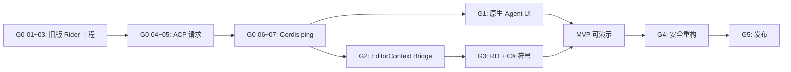

# DSH Rider Plugin — 开发 TODO / Milestones

> **版本**：v0.1 · 2026-10-26 
> **架构基线**：[DSH_Rider_Architecture_Design.md](./DSH_Rider_Architecture_Design.md) 
> **原则**：Rider 原生 UI；不使用 MCP / WebUI / Python SDK；DSH 原生上下文；Cordis 插件 + 自定义 Tool Bridge。

## 总体里程碑

| 阶段 | 优先级 | 目标 | 出口条件 |
|---|---|---|---|
| G0 · 技术可行性 | P0 | 验证兼容版本、ACP、Cordis | 旧版 Rider → DSH 往返成功 |
| G1 · 原生 Agent | P0 | 可聊天、取消、查看状态 | ToolWindow 闭环，无 UI 卡顿 |
| G2 · 工具通道 | P0 | Cordis → Kotlin 工具调用 | `rider_get_editor_context` 成功 |
| G3 · C# 语义 | P0 | RD → ReSharper 分析 | Symbol + Find Usages 成功 |
| G4 · 安全编辑 | P1 | 预览、审批、应用、撤销 | 不覆盖未保存修改，冲突阻止 |
| G5 · 发布与质量 | P1 | 兼容测试及安装包 | 选定版本矩阵验收通过 |
| G6 · 进阶能力 | P2 | Debugger、富 UI、扩展重构 | 单独 RFC 后实施 |

---

## G0 · 技术验证 / Spike（**必须先做**）

- [ ] **G0-01** 明确最低支持 Rider 版本及至少 2 个用于验证的具体 build；记录对应 JDK、Gradle 和 ReSharper SDK。
- [ ] **G0-02** 明确第一阶段 OS 支持范围、安装方式及 DSH 固定版本/commit。
- [ ] **G0-03** 使用 JetBrains 官方 ReSharper/Rider Plugin 模板启动目标旧版 Rider，ToolWindow 显示 `Hello Rider`。
- [ ] **G0-04** 手动启动 `dsh --profile acp`（根据锁定版本确认 CLI 参数），验证 ACP `initialize`、`session/new`、`session/prompt`、`session/update`。
- [ ] **G0-05** 验证 ACP `session/cancel`、权限请求应答、断线/重启时 `session/list` 与 `resume` 的实际行为。
- [ ] **G0-06** 在 `acp` Profile 中加载外部 Cordis 工具插件，注册 `rider_ping` 并由 Agent 触发。
- [ ] **G0-07** 验证自定义本地 JSON-RPC 回环：DSH Cordis → Rider Kotlin → 工具结果返回模型。
- [ ] **G0-08** 记录 ACP 不提供的 UI 数据（历史回放、计划、终端），确定 MVP 的展示降级方案。
- [ ] **G0-09** 验证目标旧版 Rider 的 RD Model 生成和 C# Backend 启动；记录实际 SDK 扩展点。
- [ ] **G0-10** 形成并归档 ADR-001 至 ADR-005；锁定协议基线与下一阶段入口。

**G0 验收**：目标旧版 Rider 的独立插件中输入问题 → DSH 回复；模型能调用一次 `rider_ping` 并拿到结果。无需 MCP/WebUI/Python。

---

## G1 · Rider 原生 Agent 基础（P0）

- [ ] **G1-01** 实现 `DshProcessManager`：按需启动、环境变量注入、stderr 日志、退出和强制清理。
- [ ] **G1-02** 实现 Kotlin ACP Client：JSON-RPC 请求关联、通知路由、错误和断流处理。
- [ ] **G1-03** 实现 `AgentSessionController`：创建、发送、取消、关闭、恢复与会话状态机。
- [ ] **G1-04** 设计原生 ToolWindow：输入框、消息区、发送/取消、基本状态与错误提示。
- [ ] **G1-05** 展示 ACP 通用流式文本/工具状态/上下文用量，UI 更新不阻塞 EDT。
- [ ] **G1-06** 实现权限请求 UI 和默认拒绝策略；禁止无界等待。
- [ ] **G1-07** Rider Project 关闭时停止接受新请求并清理当前项目 Agent/Bridge。
- [ ] **G1-08** 断线、DSH 崩溃、用户取消、项目关闭各有一条自动或可重复的测试路径。

**G1 验收**：原生聊天可用；取消有效；关闭项目不留孤儿子进程；不依赖 WebUI。

---

## G2 · 自定义 Tool Bridge（P0，先只读）

- [ ] **G2-01** 定义 Bridge v1 契约：握手、请求/响应、错误码、超时、取消、分页、版本字段。
- [ ] **G2-02** Kotlin Bridge Server 绑定 `127.0.0.1:0`，生成一次性 token，验证 project/session 隔离。
- [ ] **G2-03** Cordis `dsh-rider-tools` 插件从私有环境变量获取 endpoint/token，并完成握手与断线恢复策略。
- [ ] **G2-04** 使用 `ctx.tools.register(defineTool(...))` 注册 `rider_get_editor_context`；返回结构化内容。
- [ ] **G2-05** 实现 `EditorContextProvider`：当前文件、selection、caret、文档修改版本、未保存内容快照。
- [ ] **G2-06** 输入校验 + 文件路径 canonicalize + 限制工作区 + 消息大小/返回条数上限。
- [ ] **G2-07** Tool Bridge 对超时、取消、无项目、无编辑器、断连、错误 token 返回稳定错误码。
- [ ] **G2-08** 测试两个 Rider Project 同时打开时，A 的 Agent 无法调用 B 的工具和读取 B 的上下文。

**G2 验收**：Agent 调用 `rider_get_editor_context`，精确得到当前打开文件和选择范围；换项目、断连、取消均有正确反馈。

---

## G3 · RD Protocol / ReSharper C# 语义（P0）

- [ ] **G3-01** 基于官方模板配置 Kotlin ↔ C# RD Model，并运行代码生成。
- [ ] **G3-02** 实现 C# Backend 服务生命周期、Solution 归属与 Backend unavailable 错误处理。
- [ ] **G3-03** 实现 `rider_get_symbol_info`：名称、类型、签名、定义位置、访问修饰符。
- [ ] **G3-04** 实现 `rider_find_usages`：限量、分页/截断标识、准确定位引用位置。
- [ ] **G3-05** 实现 `rider_get_diagnostics`，返回结构化诊断；记录目标 SDK 实际可用范围。
- [ ] **G3-06** 对 C# PSI 操作加生命周期/读操作约束；多文件查询不得阻塞 EDT。
- [ ] **G3-07** 验证重命名文件、移动方法、编辑中变更、Solution Reload、Project Dispose 等边界。
- [ ] **G3-08** 建立端到端样例工程：跨 3 个文件的方法调用、接口实现、编译诊断。

**G3 验收**：Agent 通过自定义 Tool Bridge 返回的 ReSharper 语义信息，正确解释 C# 方法及其跨文件引用；不是单纯文本搜索。

---

## G4 · 安全写入与代码审查（P1）

- [ ] **G4-01** 确定 DSH 原生 FS/Bash/进程工具策略，保证内置能力不能绕过 IDE 审批；形成专项安全测试。
- [ ] **G4-02** 设计三段式协议：`preview` → 用户 `approve` → `apply`，写操作默认禁用。
- [ ] **G4-03** 集成 Rider 原生 Diff；按文件展示提议修改和冲突。
- [ ] **G4-04** 每次 Apply 校验工作区、编辑器文档版本、文件哈希和目标符号仍有效。
- [ ] **G4-05** 第一个写工具选 `rider_preview_rename` / `rider_apply_rename`，验证 ReSharper 公共重构 API。
- [ ] **G4-06** 写入走对应版本的 IDE 合法 Write Action / Command / ReSharper Transaction；支持撤销。
- [ ] **G4-07** 同时有人编辑时模拟冲突：拒绝提交或重新预览，不静默覆盖。
- [ ] **G4-08** 测试用户拒绝审批、取消等待、运行时崩溃、局部失败的状态一致性。

**G4 验收**：未授权不写；每项修改可预览；冲突必报错；成功修改可通过 IDE 撤销。

---

## G5 · 性能、测试与交付（P1）

- [ ] **G5-01** 为 Bridge 消息、Tool Schema 和错误码实现跨 Kotlin/TS 契约测试。
- [ ] **G5-02** 为 Kotlin Agent/Project 生命周期和 ACP 消息分发实现测试。
- [ ] **G5-03** 为 C# Symbol、Find Usages、Diagnostics 加测试项目和回归用例。
- [ ] **G5-04** 测试 10k+ 引用、超大文件、短时间连续提问、频繁打开关闭 Project。
- [ ] **G5-05** 检测 UI 卡顿、EDT 阻塞、异常线程持有读写锁、超时后迟到的写入。
- [ ] **G5-06** 运行 Plugin Verifier 并在最低/中间/最高目标 Rider Build 上执行 E2E。
- [ ] **G5-07** 完成 DSH 版本锁定、兼容检测、诊断日志脱敏与用户错误提示。
- [ ] **G5-08** 打包 Rider Plugin 与 Cordis 插件，验证安装、卸载、升级、断线恢复和配置迁移。
- [ ] **G5-09** 编写 `README`：依赖、支持的 IDE/OS、安装、配置、权限说明、故障排查。

**G5 验收**：目标 Rider 版本矩阵通过；安装可重复；日志无 API Key/token；关闭后无孤儿进程。

---

## G6 · 后续能力池（P2，不计入 MVP）

- [ ] **G6-01** 调研 DSH SDK 协议或额外 UI 投影，以解决 ACP 不提供完整历史/富卡片的问题。
- [ ] **G6-02** 自定义 ToolWindow 历史回放方案（不可污染 DSH 模型会话历史）。
- [ ] **G6-03** Call Hierarchy / Type Hierarchy / Safe Extract Method / Change Signature。
- [ ] **G6-04** Debugger 上下文、异常堆栈和局部变量只读分析。
- [ ] **G6-05** 项目级规则和上下文工具的渐进式披露、批量调用与结果缓存。
- [ ] **G6-06** 研究多项目共享 Runtime 与多会话并发，必须先证明隔离、取消与权限安全。

---

## 当前建议的开发顺序（关键路径）

**首个最小验收 Demo**（即将动工的第一个任务）：

1. 在旧版 Rider 里启动一个 Kotlin ToolWindow。
2. 用户输入：`请读取当前文件路径，并告诉我当前选中了多少个字符。`
3. DSH Agent 调用 `rider_get_editor_context`。
4. Cordis Plugin 通过 Tool Bridge 取得 Rider Editor 的实际状态。
5. Agent 在 ToolWindow 回答，取消按钮能够终止任务。

这条闭环完成前，**不要**投入 Rich UI、Debugger、复杂重构、跨项目 Runtime 共享或上下文压缩二次实现。

---

## 待明确的决策表（不要猜测）

- [ ] 最低 Rider 版本与首批测试 Build？
- [ ] 首批支持 Windows，还是 Windows/macOS/Linux 同步？
- [ ] 插件自己管理 DSH 安装，还是要求用户预装 `dsh`？
- [ ] DSH Runtime 是每 Project 一进程，还是有资源约束必须复用？（默认先每 Project 一进程）
- [ ] 写操作是否作为首版发布功能？（默认否）
- [ ] 是否支持完整聊天历史展示？（默认首版仅保留当前可观察对话）

## 附录：优先风险检查

- [ ] 验证 ACP 事件足以显示 MVP 工具调用状态，不假设能拿到 DSH 专属富视图。
- [ ] 验证 Cordis 外部插件能够在 `acp` Profile 被加载，并正确获得进程环境变量。
- [ ] 验证旧版 ReSharper/ RD API 能获取所需 C# Symbol 与 Usages。
- [ ] 验证 DSH 原生文件与 Shell 工具的审批不会被自定义 Bridge 绕过。
- [ ] 验证未保存文档读取与实际 IDE 缓冲区一致。
